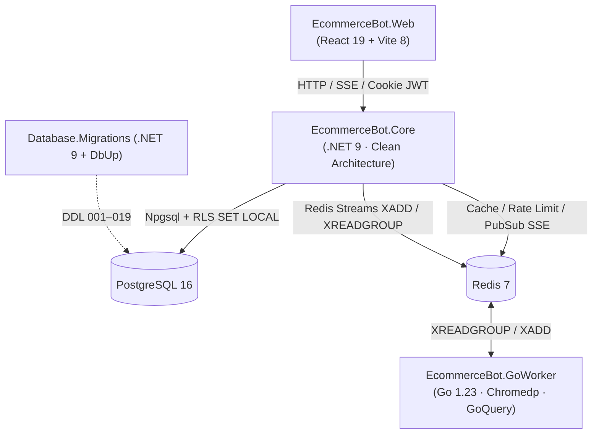

# E-commerce Bot 🛒🤖

Plataforma SaaS escalável para extração inteligente de produtos, enriquecimento de catálogo via Modelos de Linguagem, precificação e previsão de vendas com Machine Learning, além de integrações nativas com **Shopify**, **Nuvemshop** e **Mercado Pago**.

---

## 📚 Documentação Técnica de Engenharia (`/docs`)

Para a descrição consolidada de arquitetura, topologia de mensageria em Redis Streams, banco de dados PostgreSQL com RLS, segurança e operação local, consulte:

- 🏛️ [**Documentação Descritiva e Arquitetura do Sistema**](docs/architecture.md)

---

## 📁 Estrutura do Repositório (Monorepo)

O projeto é dividido em 4 pilares principais:

* ⚡ **`EcommerceBot.Core/`**: API Central em **.NET 9 (C#)** seguindo Clean Architecture / DDD, responsável por autenticação JWT, isolamento multi-tenant estrito com PostgreSQL 16 (RLS via Npgsql), persistência com Dapper, mensageria via **Redis Streams** e integrações de pagamentos.
* 🚀 **`EcommerceBot.GoWorker/`**: Microsserviço de alta performance em **Go 1.23** (Chi, Chromedp, GoQuery, go-redis) para Web Scraping evasivo e consumo assíncrono de **Redis Streams**. **Sem acesso direto ao banco de dados.**
* 🔷 **`Database.Migrations/`**: Runner de migrações determinísticas em **.NET 9** com DbUp para **PostgreSQL 16**.
* 🔵 **`EcommerceBot.Web/`**: Portal Web Frontend SPA em **React 19**, TypeScript, **Vite 8** e Tailwind CSS v4.
* 🛠️ **`infra/`**: Configurações de infraestrutura isoladas para **Desenvolvimento** (`infra/dev`) e **Produção VPS** (`infra/prod`).

---

## 🏗️ Visão Geral da Arquitetura



---

## 🚀 Como Rodar o Projeto Localmente

Consulte o passo a passo completo na [Documentação do Sistema](docs/architecture.md).

### 1. Subir a Infraestrutura (PostgreSQL 16, Redis 7):
```bash
cd infra/dev
docker compose -f docker-compose.dev.yml up -d
```

### 2. Rodar as Migrações do Banco de Dados:
```bash
dotnet run --project Database.Migrations/Database.Migrations.csproj
```

### 3. Iniciar a API Core (.NET 9):
```bash
dotnet run --project EcommerceBot.Core/src/EcommerceBot.Api/EcommerceBot.Api.csproj
```

### 4. Iniciar o Go Worker (Go 1.23):
```bash
cd EcommerceBot.GoWorker
go run cmd/worker/main.go
```

### 5. Iniciar o Frontend Web (React 19):
```bash
cd EcommerceBot.Web
npm install
npm run dev
```

---

## 🛡️ Segurança & Conformidade

- **Autenticação:** JWT com Cookies `HttpOnly` e rotação de Refresh Tokens.
- **Isolamento Multi-Tenant:** `X-Tenant-ID` validado contra claims JWT em todas as requisições autenticadas e políticas RLS no PostgreSQL 16 fail-closed via `SET LOCAL`.
- **Criptografia BYOK:** Chaves de IA de clientes cifradas com AES-256 GCM.
- **Webhooks Seguros:** Assinaturas validadas com tempo constante (`FixedTimeEquals`) e idempotência de 24 horas via Redis `SET NX`.
- **Anti-SSRF Duplo:** Proteção defensiva com `.NET UrlSecurityValidator` e `Go net.Dialer.Control` (bloqueio de loopback, redes RFC 1918 e metadados de nuvem `169.254.169.254`).
- **Análise Estática:** 100% aprovado no scanner de segurança Semgrep.
