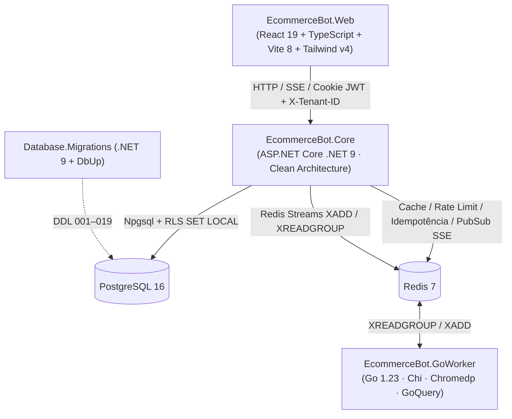

# 🏛️ Arquitetura e Descrição do Sistema — E-commerce Bot

Documento descritivo único do ecossistema **E-commerce Bot**, consolidando arquitetura, fluxos principais, persistência, mensageria, integrações, segurança e operação local.

---

## 1. Visão Geral & Topologia (Monorepo)

Plataforma SaaS multi-tenant para extração de produtos de e-commerce, enriquecimento de catálogo por IA (OpenRouter), checkout de créditos (Mercado Pago) e sincronização com **Shopify** e **Nuvemshop**.



### Pilares do Repositório

| Pilar | Stack | Responsabilidade Principal |
|---|---|---|
| **`EcommerceBot.Web`** | React 19, TypeScript, Vite 8, Tailwind CSS v4 | Portal SPA estático (servido via Nginx em produção, sem Node SSR). Camadas estritas `Types -> Services -> Hooks -> Components/Pages`, autenticação JWT via cookie/storage e cliente SSE (`events:tenant:{tenantId}`). |
| **`EcommerceBot.Core`** | .NET 9 (C#), ASP.NET Core, Dapper, Npgsql, Redis Streams | Core API transacional em Clean Architecture / DDD (`Domain`, `Application`, `Infrastructure`, `Api`) + servidor de observabilidade `EcommerceBot.Diagnostics.Mcp` (`stdio`). Orquestra auth JWT, multi-tenancy com RLS via Npgsql, mensageria via Redis Streams (BackgroundServices), LLM (OpenRouter), pagamentos (Mercado Pago), e-mails Razor (`.cshtml` via Resend) e gateways Shopify/Nuvemshop. |
| **`EcommerceBot.GoWorker`** | Go 1.23, Chi, Chromedp, GoQuery, go-redis | Microsserviço assíncrono de alta performance para web scraping evasivo multi-tier (Tier 1 HTTP seguro + Anti-SSRF em `net.Dialer.Control`, Tier 2 browser stealth + JSON-LD) e consumo de Redis Streams (`stream:scraping:*`). |
| **`Database.Migrations`** | .NET 9 (C#), DbUp.PostgreSQL, Npgsql | Runner determinístico de scripts PL/pgSQL (`001`–`019`) com Row Level Security (`CREATE POLICY` com `security.fn_tenant_access`), funções de auditoria e bootstrap de SuperAdmin no PostgreSQL 16. |
| **`infra/`** | Docker Compose, Nginx, Bash | Topologia local (`infra/dev`) e produção VPS (`infra/prod` com Nginx edge, TLS, Workstation GC e scripts de backup/restore PostgreSQL no Cloudflare R2). |

---

## 2. Fluxos Principais Ponta a Ponta

1. **Extração & Enriquecimento de Produtos:**
   - Lojista envia URL via SPA → Core valida Anti-SSRF (`UrlSecurityValidator`), reserva/debita crédito e despacha mensagem no Redis Stream (`stream:scraping:prod` / `stream:scraping:demo`).
   - Go Worker valida `ValidateURLSafety` (Anti-SSRF com `net.Dialer.Control`), extrai HTML/JSON-LD via GoQuery/Chromedp e publica `ScrapedRawProductEvent` em `stream:scraped:results`.
   - `ScrapedProductStreamConsumer` (Core .NET `BackgroundService`) consome com `XREADGROUP`, consulta diretrizes de SEO (`CategorySeoGuidelines`), aciona OpenRouter (`OpenRouterGateway`), persiste em `dbo.products`, registra telemetria em `dbo.llm_usage_logs` e publica evento em `events:tenant:{tenantId}` (SSE).
2. **Wallet, Checkout & Ledger de Créditos:**
   - SPA tokeniza cartão via `@mercadopago/sdk-react` ou solicita QR PIX (`POST /api/v1/wallet/recharge`) → `MercadoPagoGateway` cria ordem na API v1 do Mercado Pago e persiste `dbo.orders` / `dbo.order_items`.
   - Webhook `POST /api/v1/webhooks/mercadopago` valida HMAC `x-signature`, aplica idempotência no Redis e publica no stream `stream:payments:process`.
   - `PaymentProcessingStreamConsumer` reconcilia o pagamento, registra entrada/estorno no ledger append-only (`dbo.credit_transactions`), notifica via SSE e dispara notificação em `stream:notifications:email`.
3. **Integrações Shopify & Nuvemshop:**
   - Conexão via OAuth 2.0 ou token direto cifrado com **AES-256 GCM** em `dbo.store_integrations`.
   - Sincronização individual ou em lote via Redis Streams (`stream:sync:shopify`, `stream:sync:nuvemshop`) consumidos por `ShopifyBulkSyncStreamConsumer` e `NuvemshopBulkSyncStreamConsumer` via GraphQL Admin (`2024-01+`) ou Nuvemshop REST v1, além de webhooks reativos com validação HMAC.

---

## 3. Banco de Dados & Segurança

- **PostgreSQL 16 (`Database.Migrations/Scripts/001`–`019`):** Chaves primárias `UUID DEFAULT gen_random_uuid()`, timestamps `TIMESTAMPTZ`, Row Level Security nativo (`CREATE POLICY` com predicado `security.fn_tenant_access(tenant_id)` ativado em todas as tabelas tenant-scoped via transação com `SET LOCAL app.tenant_id = '...'`), segregação de usuários e tabelas principais (`tenants`, `users`, `roles`, `products`, `orders`, `order_items`, `plans`, `credit_transactions`, `ai_provider_credits`, `llm_usage_logs`, `store_integrations`, `tenant_configs`, `traffic_attributions`, `enterprise_leads`, `audit_logs`, `email_logs`, `robot_activities`, `category_seo_guidelines`).
- **Controles de Segurança:** Autenticação JWT (cookie `HttpOnly` + Bearer), isolamento multi-tenant via `TenantHeaderMiddleware` (`X-Tenant-ID`), criptografia BYOK AES-256 GCM (`AesGcmCryptoService`), comparação de HMAC em tempo constante (`CryptographicOperations.FixedTimeEquals`), proteção Anti-SSRF em duas camadas (.NET Core e Go Worker com bloqueio de loopback/RFC 1918) e rate limiting por endpoint/borda.

---

## 4. Execução Local & Checagens

```bash
# 1. Infraestrutura (PostgreSQL 16, Redis 7)
cd infra/dev && docker compose -f docker-compose.dev.yml up -d

# 2. Migrações PostgreSQL
dotnet run --project Database.Migrations/Database.Migrations.csproj

# 3. Core API (.NET 9)
dotnet run --project EcommerceBot.Core/src/EcommerceBot.Api/EcommerceBot.Api.csproj

# 4. Go Worker (Web Scraping & Redis Streams)
cd EcommerceBot.GoWorker && go run cmd/worker/main.go

# 5. Frontend SPA (React 19 + Vite 8)
cd EcommerceBot.Web && npm install && npm run dev
```

### Validações de Build e Testes
- **Backend .NET:** `dotnet build EcommerceBot.Core/EcommerceBot.Core.sln` e `dotnet test EcommerceBot.Core/EcommerceBot.Core.sln`
- **Migrações:** `dotnet build Database.Migrations/Database.Migrations.csproj`
- **Frontend Web:** `npm run lint && npm run build && npm test` (em `EcommerceBot.Web/`)
- **Go Worker:** `go build ./cmd/worker/...` e `go test ./...` (em `EcommerceBot.GoWorker/`)
- **Grafo de Código (Graft):** `graft check` / `graft build`

---

## 5. Navegação de Código & Invariantes Fail-Closed

### Navegação obrigatória (Graft)

O repositório é indexado em `graft/` (nós markdown com spans `file:line` sincronizados via git). Antes de qualquer `grep` manual ou leitura de arquivo:

- `graft map` — orientação inicial (clusters de diretórios, hubs, hotspots).
- `graft ask "<pergunta>" --source` — nó ranqueado com o trecho relevante inline (`--full` para definições inteiras).
- `graft grep "<literal>"` — busca exaustiva agrupada por símbolo (para "todas as ocorrências").
- `graft skeleton <file>` — assinaturas + spans, ~10x mais barato que ler o arquivo.
- `graft callers <symbol>` — arestas exatas de chamada (`--direction out`, `--depth N` para raio de impacto).
- Após mudanças estruturais, rodar `graft build` para manter o grafo fresco.

### Invariantes (violação = bloqueio de merge)

1. **Isolamento multi-tenant em SQL (PostgreSQL RLS):** toda query/comando Dapper em tabela tenant-scoped deve executar dentro de transação explícita com `SET LOCAL app.tenant_id = '...'` e `SET LOCAL app.is_super_admin = '...'` (aplicado via `DbConnectionFactory`), mantendo as policies `tenant_isolation` ativas como fail-closed.
2. **Isolamento do Go Worker:** proibido conectar diretamente ao banco relacional PostgreSQL ou importar SDKs de LLM externos (`openai`, `anthropic`, `openrouter`). Comunicação apenas por Redis Streams; orquestração de LLM vive exclusivamente no `EcommerceBot.Core`.
3. **Zero fallback estático de secret:** nunca usar `?? "default_secret"` para JWT, AES, chave interna de serviço ou webhook. Lançar `InvalidOperationException` ou retornar `401` (fail-closed).
4. **Sem escalação de privilégio:** endpoints de perfil (`UpdateProfileAsync`) não podem aceitar nem mutar `Role`. Registros padrão nascem como `MEMBER` e nunca aceitam `TenantId` arbitrário sem autorização/convite.
5. **Sem colisão de rotas HTTP:** proibido declarar o mesmo caminho de rota em controllers/actions distintos (`AmbiguousMatchException`).
6. **Verificação de webhook em tempo constante:** Mercado Pago, Shopify, Nuvemshop e Svix/Resend somente via `CryptographicOperations.FixedTimeEquals` + idempotência `SET NX` no Redis por 24h (só após processamento durável/enfileiramento).
7. **Anti-SSRF em duas camadas:** permitir apenas `http://` e `https://`; bloquear loopback, faixas privadas RFC 1918, link-local/metadata (`169.254.169.254`), `0.0.0.0`, ULA IPv6/loopback mapeado; validar DNS e redirects HTTP tanto na API .NET (`UrlSecurityValidator`) quanto no Go Worker (`ValidateURLSafety` com `net.Dialer.Control`).
8. **Sem HTML inline em e-mails:** no Core, Razor `.cshtml` em `src/EcommerceBot.Api/Views/Emails/` + ViewModel em `src/EcommerceBot.Application/ViewModels/Emails/` via `IRazorTemplateRenderer`.
9. **Bootstrapping limpo:** `Program.cs` é apenas orquestração de pipeline; DI/options/middleware ficam em `Configurations/` e `Middlewares/`. Em produção, Workstation GC (`DOTNET_ServerGarbageCollection=0`, `DOTNET_GCHeapHardLimit=0x10000000`, `DOTNET_GCTrimCommit=1`) para proteger o VPS de 4 GB.
10. **MCP de diagnóstico read-only (`EcommerceBot.Diagnostics.Mcp`):** expor somente consultas read-only (PostgreSQL `pg_stat_activity`, Redis, logs); nunca vazar secrets nem executar DML/DDL dinâmico.

### Regras do Frontend SPA

- Isolamento estrito em 4 camadas (`Types -> Services -> Hooks -> Components/Pages`): componentes e páginas nunca importam `services/` nem `apiClient` diretamente.
- Configuração via `@/config/env` (sem `import.meta.env` espalhado), WCAG 2.1 AA (`min-h-[44px]`, inputs `>= 16px`) e teto de **350 linhas por arquivo** (ESLint `max-lines`, sem `eslint-disable`).
