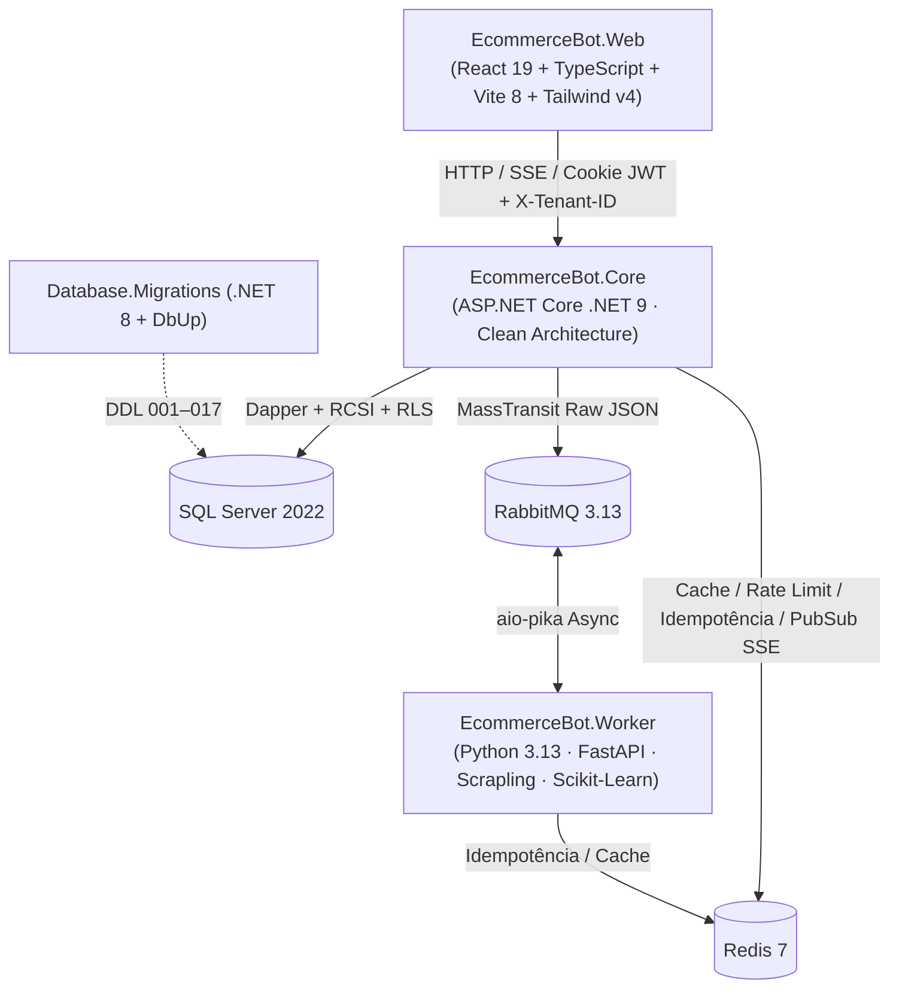

# 🏛️ Arquitetura e Descrição do Sistema — E-commerce Bot

Documento descritivo único do ecossistema **E-commerce Bot**, consolidando arquitetura, fluxos principais, persistência, mensageria, integrações, segurança e operação local.

---

## 1. Visão Geral & Topologia (Monorepo)

Plataforma SaaS multi-tenant para extração de produtos de e-commerce, enriquecimento de catálogo por IA (OpenRouter), previsão/segmentação analítica com Machine Learning local (Scikit-Learn), checkout de créditos (Mercado Pago) e sincronização com **Shopify** e **Nuvemshop**.



### Pilares do Repositório

| Pilar | Stack | Responsabilidade Principal |
|---|---|---|
| **`EcommerceBot.Web`** | React 19, TypeScript, Vite 8, Tailwind CSS v4 | Portal SPA estático (servido via Nginx em produção, sem Node SSR). Camadas estritas `Types -> Services -> Hooks -> Components/Pages`, autenticação JWT via cookie/storage e cliente SSE (`events:tenant:{tenantId}`). |
| **`EcommerceBot.Core`** | .NET 9 (C#), ASP.NET Core, Dapper, MassTransit | Core API transacional em Clean Architecture / DDD (`Domain`, `Application`, `Infrastructure`, `Api`) + servidor de observabilidade `EcommerceBot.Diagnostics.Mcp` (`stdio`). Orquestra auth JWT, multi-tenancy, LLM (OpenRouter), pagamentos (Mercado Pago), e-mails Razor (`.cshtml` via Resend) e gateways Shopify/Nuvemshop. |
| **`EcommerceBot.Worker`** | Python 3.13, FastAPI, `aio-pika`, Scrapling, Camoufox, Scikit-Learn | Microsserviço assíncrono isolado de banco relacional e de LLMs externas. Executa web scraping evasivo multi-tier (JSON `.json`, Tier 1 TLS HTTP, Tier 2 browser stealth + JSON-LD/Markdown) e inferência local de ML (RFM, Churn, LTV, Capacity). |
| **`Database.Migrations`** | .NET 8 (C#), DbUp | Runner determinístico de scripts T-SQL (`001`–`017`) com `RCSI`, `ALLOW_SNAPSHOT_ISOLATION ON` e políticas de segurança no SQL Server 2022. |
| **`infra/`** | Docker Compose, Nginx, Bash | Topologia local (`infra/dev`) e produção VPS (`infra/prod` com Nginx edge, TLS e scripts de backup/restore SQL Server no Cloudflare R2). |

---

## 2. Fluxos Principais Ponta a Ponta

1. **Extração & Enriquecimento de Produtos:**
   - Lojista envia URL via SPA → Core valida Anti-SSRF (`UrlSecurityValidator`), reserva/debita crédito e despacha `ScrapingRequestMessage` via RabbitMQ (`ecommerce` / `demo_ecommerce`).
   - Worker Python valida `validate_url_safety`, extrai HTML/JSON-LD/Markdown via Scrapling e publica `ScrapedRawProductEvent` em `ecommerce_scraped_queue`.
   - `ScrapedProductConsumer` (Core .NET) consulta diretrizes de SEO (`CategorySeoGuidelines`), aciona OpenRouter (`OpenRouterGateway`), persiste em `dbo.Products`, registra telemetria em `dbo.LLMUsageLogs` e publica evento em `events:tenant:{tenantId}` (SSE).
2. **Wallet, Checkout & Ledger de Créditos:**
   - SPA tokeniza cartão via `@mercadopago/sdk-react` ou solicita QR PIX (`POST /api/v1/wallet/recharge`) → `MercadoPagoGateway` cria ordem na API v1 do Mercado Pago e persiste `dbo.Orders` / `dbo.OrderItems`.
   - Webhook `POST /api/v1/webhooks/mercadopago` valida HMAC `x-signature`, aplica idempotência no Redis e publica na fila `payments_process_queue`.
   - `PaymentProcessingConsumer` reconcilia o pagamento, registra entrada/estorno no ledger append-only (`dbo.CreditTransactions`), notifica via SSE e dispara e-mail de confirmação (`email_notifications`).
3. **Integrações Shopify & Nuvemshop:**
   - Conexão via OAuth 2.0 ou token direto cifrado com **AES-256 GCM** em `dbo.StoreIntegrations`.
   - Sincronização individual ou em lote (`shopify_bulk_sync`, `nuvemshop_bulk_sync`) via GraphQL Admin (`2024-01+`) ou Nuvemshop REST v1, além de webhooks reativos com validação HMAC.
4. **Analytics Preditivo (ML) & Tráfego:**
   - Core publica jobs em `analytics_ml_queue` → Worker executa `RFMSegmentation`, `ChurnPredictor`, `LTVForecaster` e `TokenCapacityForecaster` (com suporte a artefatos `.joblib`) em `asyncio.to_thread` e devolve em `analytics_processed_queue` → `AnalyticsProcessedConsumer` grava em `dbo.RobotActivities` e emite via SSE.

---

## 3. Banco de Dados & Segurança

- **SQL Server 2022 (`Database.Migrations/Scripts/001`–`017`):** Chaves `UNIQUEIDENTIFIER DEFAULT NEWSEQUENTIALID()`, timestamps `DATETIMEOFFSET`, RCSI habilitado, RLS (`Security.TenantSecurityPolicy` via `SESSION_CONTEXT`), segregação de usuários (`usr_ecommerce_deployer` vs `usr_ecommerce_api`) e tabelas principais (`Tenants`, `Users`, `Roles`, `Products`, `Orders`, `OrderItems`, `Plans`, `CreditTransactions`, `AiProviderCredits`, `LLMUsageLogs`, `StoreIntegrations`, `TenantConfigs`, `TenantAiCredentials`, `TenantBillingProfiles`, `TenantSsoMappings`, `TrafficAttributions`, `EnterpriseLeads`, `AuditLogs`, `EmailLogs`, `RobotActivities`, `CategorySeoGuidelines`, `SaasAdSpends`).
- **Controles de Segurança:** Autenticação JWT (cookie `HttpOnly` + Bearer), isolamento multi-tenant via `TenantHeaderMiddleware` (`X-Tenant-ID`), criptografia BYOK AES-256 GCM (`AesGcmCryptoService`), comparação de HMAC em tempo constante (`CryptographicOperations.FixedTimeEquals`), proteção Anti-SSRF e rate limiting por endpoint/borda.

---

## 4. Execução Local & Checagens

```bash
# 1. Infraestrutura (SQL Server 2022, Redis, RabbitMQ)
cd infra/dev && docker compose -f docker-compose.dev.yml up -d

# 2. Migrações SQL Server
dotnet run --project Database.Migrations/Database.Migrations.csproj

# 3. Core API (.NET 9)
dotnet run --project EcommerceBot.Core/src/EcommerceBot.Api/EcommerceBot.Api.csproj

# 4. Worker Python (FastAPI + aio-pika)
cd EcommerceBot.Worker && uvicorn app.main:app --host 0.0.0.0 --port 8000 --reload

# 5. Frontend SPA (React 19 + Vite 8)
cd EcommerceBot.Web && npm install && npm run dev
```

### Validações de Build e Testes
- **Backend .NET:** `dotnet build EcommerceBot.Core/EcommerceBot.Core.sln` e `dotnet test EcommerceBot.Core/EcommerceBot.Core.sln`
- **Migrações:** `dotnet build Database.Migrations/Database.Migrations.csproj`
- **Frontend Web:** `npm run lint && npm run build && npm test` (em `EcommerceBot.Web/`)
- **Worker Python:** `EcommerceBot.Worker\.venv\Scripts\pytest.exe -q` (em `EcommerceBot.Worker/`)
- **Grafo de Código (Graft):** `graft check` / `graft build`
